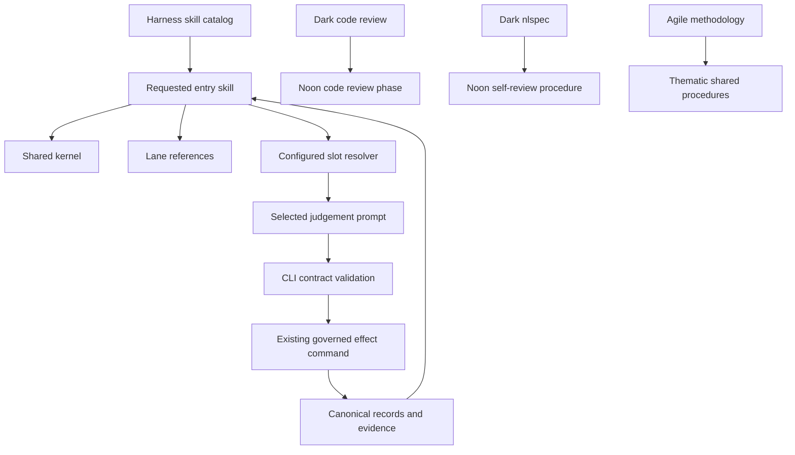

# Skill determinism and prompt cost audit

Pinned source: `f767bdd1c0a78f6259c335742c1567a074f512a0`, 14 November 2026.

The largest opportunity is to move repeated control flow into bounded CLI operations and load only the judgement needed for the current step. Removing a skill family alone will save relatively little of a heavy entry's loaded context and can break dependencies. No production skill, default, installed link or runtime module was changed during this audit.

The audit covers all 32 shipped skills and nine shared reference files. [The inventory](data/inventory.json) records every byte in 6,793 contiguous blocks, including 4,234 non-whitespace blocks and 532 headings. The semantic tables below review sections and significant rule groups. A structural block can contain several obligations; it is not automatically one independently reviewed rule. Before deletion, split each affected block into separately testable obligations in that slice's rule inventory.

| Read | Contents |
|---|---|
| [Entry skills](entry-skills.md) | Routing, preparation, creation, grooming, build, unattended orchestration and onboarding |
| [Shared prose](shared-prose.md) | Gateway, kernel, shared contracts, state/effect rules and V5 constraints |
| [Slot skills](slot-skills.md) | Every producer, adapter, methodology and executor; noon/dark composition |
| [Measurements and experiment protocol](measurements.md) | Recomputed historic costs, current loaded sizes, accounting limits, paired comparisons |
| [Implementation plan](implementation-plan.md) | Ordered slices, interfaces, files, parity tests and rollback |

## What should move, and what should remain

| Prose function | Treatment | Required evidence before removing it |
|---|---|---|
| Enum, schema, default, flag precedence, parser rule | One CLI/schema owner; return a small result | Boundary-value and malformed-input tests; exact output/exit compatibility |
| Read, validate, choose a mechanical branch, persist, retry, stop | Bounded command with explicit inputs, finite outcomes and an effect boundary | Before/after ordered read, decision, mutation-attempt, mutation-result and terminal traces |
| Decide whether a finding is founded, an ambiguity matters, a design fits, work is worth doing | Retain a focused judgement prompt | Pinned-model paired evals, negative cases and preserved rubric obligations |
| Mixed judgement and sequencing | CLI requests a typed judgement, validates its response, then applies policy | Missing/invalid/stale judgement must block; model cannot supply authority |
| Exact repeated rule | One canonical implementation or shared judgement fragment | All consumers proven to receive the replacement, including standalone invocation |
| Historical rationale, sales copy, repeated explanation | Remove from runtime or move to reference documentation | A reviewer confirms no constraint or exception is lost |
| Stale or conflicting assertion | Resolve explicitly; never count as a free parity-preserving deletion | Decision recorded separately from extraction, with a changed-behaviour fixture |

Literal prose equivalence is impossible where the prose contradicts itself or the current executable behaviour. Exact parity is a testable claim for defined inputs and observable transitions. Judgement equivalence is a statistical and rubric-preservation claim. Neither a green unit suite nor a count of deleted bytes proves both.

## Composition and the costly path

The JSON inventory includes forward and reverse-queryable textual references. A textual mention is deliberately not labelled an invocation or load. The semantic tables describe the actual relationships. [Entry loads](data/entry-loads.json) measure the explicit load preambles, excluding negative read pointers.

| Entry | Own estimated tokens | Shared references | Cold-entry total |
|---|---:|---:|---:|
| graft | 44,384 | 63,115 | 107,499 |
| beep-boop | 39,018 | 61,228 | 100,246 |
| prep | 25,883 | 53,661 | 79,544 |
| tidy | 18,866 | 54,767 | 73,633 |
| plot | 11,342 | 54,039 | 65,381 |
| jot | 5,804 | 50,412 | 56,216 |
| wtf | 7,806 | 38,418 | 46,224 |
| map | 6,049 | 38,418 | 44,467 |
| onboard | 5,733 | 29,640 | 35,373 |

These use the existing `ceil(chars/4)` estimator. They exclude system instructions, catalog wrappers, delegated prompts, contract descriptions, tools and history. Files loaded in one conversation remain resident until context management removes them. Splitting a file and eventually reading all parts in the same conversation does not remove that resident cost. A fresh bounded worker can reduce its own context, but its output and any inherited parent context must also be measured.

The [section-size census](data/section-sizes.json) identifies where to focus. These are source sizes, not promised removable tokens.

| Source section | Estimated tokens | Main treatment |
|---|---:|---|
| Graft Process, lines 36-708 | 36,890 | Reuse shipped admission/worktree/spec/PR/landing commands; extract remaining bounded sequences |
| Beep-boop Full pipeline, lines 130-380 | 18,528 | Typed trigger, admission, phase and return handling |
| Dark code-review provider integration, lines 134-335 | 10,792 | Transport/prompt preparation in code; retain the actual review rubric |
| Prep spec-review gate, lines 88-274 | 10,530 | Existing round/hold/convergence commands plus proven remaining sequencing |
| Kernel Shared Rules, lines 185-349 | 7,191 | Split unrelated rules by consumer; retain judgement and authority limits |
| Kernel contracts/slots, lines 377-464 | 7,186 | Contract validation/descriptions and explicit loading manifest |
| Kernel configuration, lines 31-168 | 6,624 | Resolver/default/schema authority in CLI, minimal usage instructions |

The three kernel sections affect almost every entry. Review transport and prep's gate are a relatively focused next extraction after capture and loading proof. Graft and beep-boop offer larger savings but carry more effect-order and recovery risk.

## Defaults, tier names and unused skills

The checked-in default registry chooses noon occupants. This repository's local configuration already selects dark spec, spec-review, review and parallel concurrency. The maintainer clarified during this audit that dark should become the default and noon should be put aside, with removal considered only after third-party usage exists. The plan records that decision; changing the runtime defaults is an implementation slice, separate from parity-preserving extraction.

- There are five noon/dark pairs: spec, spec-review, code review, methodology and concurrency. These are not five interchangeable quality levels. Parallel execution and agile methodology change operational policy.
- Nine noon occupants have no dark replacement: ADR, architecture, both environment producers, evaluator, intake, PRD, ship and transport.
- Dark nlspec, dark review and agile methodology depend on noon behaviour. Extract the shared core before removing aliases or bodies.
- Switch all five paired slots to their dark occupants. Verify methodology and concurrency as distinct behaviour changes, including capability requirements and existing concurrency caps. A backend outage must not silently downgrade adversarial review.
- Give internal producers role names and a resolver manifest. Move noon out of default discovery/loading, keeping explicit legacy selection and required shared internals available. Keep old configured identifiers as aliases to the appropriate implementation for a declared compatibility period. Only remove basic modes after their remaining consumers and third-party uses have been measured.
- Hiding a command from the user menu is not enough: `link-skills.sh` discovers every top-level directory containing `SKILL.md`. Internal prompt files must leave that discovery surface, or the installer/package must expose an explicit public entry set.
- Both plugin and global installations appear in the active catalog. [Disk readings](data/installed-catalog.json) find 32 plugin skills and 31 global links. Description text alone is approximately 2,704 plus 2,596 tokens, excluding harness formatting. Removing duplicate discovery is worthwhile but cannot explain the entire 100k-token build entry. Do not remove an installation automatically: verify which source the invoking harness resolves and preserve CLI availability.

## Highest-risk findings

These are priorities for the ambiguity register and proof work. The linked semantic audits provide line ranges and backing code.

The newest committed capture set was replayed during this audit: 40 graded decisions, 26 agreements and 14 divergences classified as wasted work, all in `next` routing. Six of nine kernels have no graded observations. This supports a targeted sequencing investigation; it is not a measured whole-system defect rate or blanket V5 gate acceptance. See the [saved replay](data/post-fix-fidelity/result.json).

| Finding | Failure risk | Required action |
|---|---|---|
| A CLI kernel exists, but the agent must invoke it, choose its result and remember the next mutation | Skipped checks, reordered effects, fabricated success | Make the bounded operation own the sequence, then test attempts and results |
| Sequential and parallel corrective recovery disagree about custody manifest input and trusted verdicts | One executor rejects valid evidence or accepts weaker evidence | Pin current behaviours independently; settle intended contract before unifying |
| Spec discovery both allows a formal spec in the issue body and forbids descriptions | A new parser can silently widen or narrow build admission | Add conflicting examples and obtain an explicit policy resolution |
| Shared delivery prose keys holdout to L4 while the executable floor reads capability facts | A prose extraction can reintroduce a bypass | Treat current floor implementation as the effect authority; record prose correction |
| Some environment/refutation prose disagrees with implemented seed/parser rules | Wrong schemas or dropped accepted inputs | Characterise actual accepted/rejected input sets and record intended corrections |
| Standalone/ambient loading and nested slot dependencies are implicit | Missing safety or judgement context after slimming | Test every standalone, parent and subagent entry separately |
| Model-compliance assertions and dated implementation claims are mixed | Documentation can overstate enforcement or obscure existing enforcement | Classify invocation, prevention, detection and judgement evidence separately |
| Rule-inventory and scripted harness checks can pass without running revised prose | False proof of behavioural parity | Keep these checks, add real-prompt paired runs and independent effect capture |

## What was built and verified in this audit

`eval/skill-audit.mjs` regenerates the structural inventory, cold-entry size measurements and historical cost comparison. Its tests check gap-free byte coverage, fenced-code parsing, negative load pointers and the actual shipped tree.

`eval/control-parity.mjs` compares supplied normalised traces. It rejects empty suites, missing scenarios, changed fixture/policy hashes, unknown event kinds and incomplete terminal evidence. It catches seeded changes to effect attempts, outcome, read order and decisions. It does not execute a skill or attest capture completeness. Production old/new drivers are a planned prerequisite, not an already-proven property.

Existing targeted harness, tokenomics, prefix-planner, rule-inventory and fidelity tests were also exercised. Four fidelity tests initially failed because their temporary-repository commits inherited this machine's SSH signing requirement. Re-running that suite with `commit.gpgsign=false` scoped to the test process passed all 14. No global Git setting was changed. Detailed counts and commands are in [measurements](measurements.md).

No live model A/B comparison has been run against edited production prose: there is no edited production candidate yet. Historical counterfactual costs are labelled as such. No eval baseline was rewritten.
