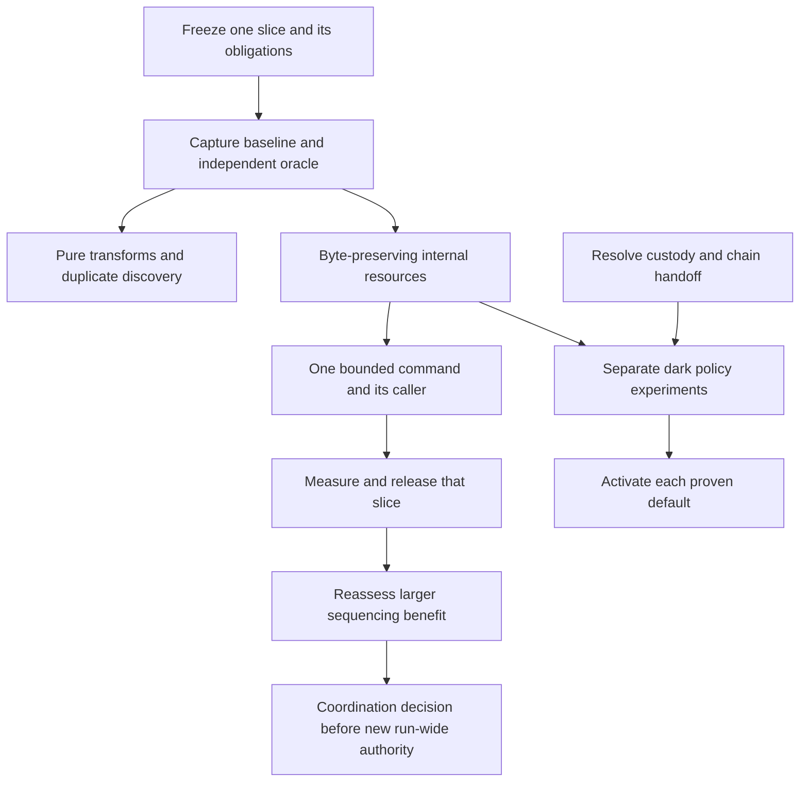

# Adversarial review of the skill determinism migration

Reviewed 14 November 2026 against `f767bdd1c0a78f6259c335742c1567a074f512a0`. HEAD matches the audit pin. The initial working tree contained the untracked audit, its two evaluation tools and tests, and the pre-existing runner-pull directory. This review changed none of those inputs, production sources, installed links or configuration. New evidence is under [astra-review-data](astra-review-data/).

## Decision

| Scope | Opinion | Conditions |
|---|---|---|
| Measurement, independently captured baseline, pure text transformations | Go | Scope obligations to the selected slice; retain external-effect ownership and judgement. |
| Remove duplicate discovery, introduce internal prompt loading | Conditional go | First prove which installation supplies the selected skill, installed helper/resource reachability, aliases and cold standalone loading. Measure the actual harness catalogue. |
| Dark defaults for all five paired slots | Accept the product direction; no-go for activation in the plan's present order | Finish the shared dependencies, capability preflight and concurrency/custody corrections first. Evaluate each policy change separately. Keep noon explicitly selectable. |
| Entire twelve-task migration | No-go as an execution-ready programme | Close the ranked conditions below and stage release decisions after measured slices. The plan is a useful design inventory, not completed proof or a reliable savings forecast. |
| Noon removal | No-go in this migration | The user requires third-party adoption evidence before considering retirement. Nine capabilities also have no dark replacement. |

No production candidate exists, so there is no measured treatment benefit or demonstrated migration regression. The principal objections concern the proposed order, proof contract and interpretation of historical evidence. Several are limitations the audit already acknowledges; acknowledging them does not discharge them.

## Independently verified readings

| Reading | Recheck | What it establishes |
|---|---|---|
| Source census | 32 skills plus nine references, 1,371,305 bytes, 339,730 `ceil(JS string length / 4)` tokens | The reported source size is correct. This is neither provider tokenisation nor resident request usage. |
| Heavy cold entries | Graft 107,499; beep-boop 100,246; prep 79,544 estimated tokens | Their explicit initial load instructions are large. These exclude subsequent occupants, tools, history and the harness catalogue. |
| Installed copies | Plugin 32, global links 31; every inspected body matches the checkout | Duplicate discovery is real. It does not mean both bodies are loaded. The global copy lacks `faffter-noon-env-code-interface`. |
| Description proxy | Audit 2,704/2,596; description values alone 2,584/2,480 | The audit counts the complete `description:` source line, including YAML key and quotes. Its number is a source-declaration proxy, not exact description or catalogue tokens. |
| August accounting | 19 transcripts, 2,281 usage rows, 843 request IDs; no cross-file duplicate IDs, malformed lines or assistant rows missing IDs | The chosen accounting path reproduces. Streaming rows must not be counted as requests. |
| August usage | 155,078,239 cache-read; 4,241,578 cache-write; 1,686 other input; 995,907 output tokens | Cache-write buckets reconcile exactly. Repeated cache reads are billable/modelled request usage, not unique source bytes. |
| Historical modelled cost | $132.913: read $77.539, write $30.467, other input $0.008, output $24.898 | The audit's historical table reproduces. It is not a current quote, invoice or cost per successful task. |
| October replay | 40 comparisons, 26 agreements, 14 classifier-labelled wasteful differences | Correct as output of this replay method. The interpretation requires the qualifications below. |
| September local replay | 11 captured inputs, zero graded decisions, 11 uncaptured actions | Reproduces `null_result:false` despite no comparative evidence. Never treat it as zero observed defects. |
| Five selected local Codex sessions | File hashes and last cumulative usage totals match; two have counter resets | Convenience-sample context readings only. They are not request counts, complete lifetime totals or a cost baseline. |

Reproduction and hashes are in [review-probes.mjs](astra-review-data/review-probes.mjs), [independent census](astra-review-data/independent-census.json), [historical accounting](astra-review-data/historical-accounting.json), [installed reading](astra-review-data/installed-reading.json) and [provenance](astra-review-data/provenance.json). The census independently reads source bytes; the historical calculation deliberately uses the repository parser and historical tariff, then audits its request IDs and bucket accounting. It does not independently validate provider billing. [Local readings](astra-review-data/local-readings.mjs) also recheck the selected Codex files and the read-only September pull; they do not validate the original newest-session selection or representativeness.

The audit correctly distinguishes several boundaries that are often overstated:

- `graft-admit.ts:4-8,154-181` validates caller facts and composes existing kernels. It does not fetch tracker truth, acquire the build claim or append admission.
- `prep-attach.ts:372-381` confirms local staged bytes and a supplied comment ID. It never verifies remote storage.
- `spec-review-hold.ts:325-350` changes the local hold and returns label operations. It does not apply those operations remotely.
- `next.js:1-4,43-66` prescribes a route over supplied facts. It neither executes that route nor subsumes every later gate.
- `test/helpers/skill-harness.mjs:9-26` explicitly describes a scripted CI driver and attempted tracker mutations. Passing it does not show that revised prompts ran or that the tracker changed.

The review independently inspected these implementations, relevant source prompts, configuration and installer/validator paths. It did not re-prove every semantic row in the three large audit inventories. Their gap-free structural coverage is useful for locating obligations, not certification that every obligation has been identified.

## Findings ranked by severity

### High: the default flip precedes proof of the behaviour it activates

[Implementation plan lines 42-55 and 130-135](implementation-plan.md#L130) make task 4 depend on loading, but not on task 9's executor reconciliation. The parallel default would therefore activate while the plan still lists unresolved custody and chain-handoff behaviour. Splitting review, methodology and concurrency into sub-slices is sensible, but their release dependencies must be explicit.

The difference is executable policy, not naming:

- `config-core.js:17-38` defaults to sequential execution, noon review/spec/spec-review and thematic methodology, with `concurrency_max:4`.
- `faffter-dark-concurrency-parallel/SKILL.md:32-48` requires background build subagents, whole-chain dispatch and per-member return/merge handling. Lines 41 and 87-91 use different corrective/custody treatment from sequential lines 32 and 42-46.
- Parallel line 48 requires a dependent's blocker to have merged, while line 43 says the child stops at PR-ready and the parent merges. A whole chain cannot simply wait for all members before returning and also wait for the parent's intermediate merge. The plan needs a concrete member handoff, not another assertion that both rules are preserved.
- `corrective.js:253-267,549-594` makes the held manifest material to `custody-trusted` versus `channel-D`/refusal. Parallel omits the manifest. Removing the difference is a correction with its own oracle.
- `faffter-dark-methodology-agile-delivery/SKILL.md:106,122-130,259-268` changes default landing, ordering and topology treatment. `appetite` defaults to high. This is not a cheap quality tier switch.

Task 4 also refers to parallel infrastructure's "existing refusal" at line 131, but the inspected executor prompt does not define a complete capability preflight or named refusal contract for a harness lacking the required launch/wait semantics. The kernel's producer-dispatch variants at `kernel.md:331-336` are not a complete parallel scheduler capability test.

Required change: make activation depend on the proven executor boundary, all relevant ambiguity resolutions and an installed-harness capability matrix. Test no-agent, background-only, child-return loss, slow live member, parent restart and collision-chain intermediate merge. Missing infrastructure must produce an explicit outcome before any dispatch. A default of parallel with cap 1 still changes dispatch posture and must be tested as its own mode. Explicit noon/custom selection must keep its old behaviour.

### High: October's 14 differences do not establish 14 units of avoidable work

The replay's `wasteful` category is the residual branch of `shadow-fidelity.js:191-217`. In particular, `graft -> none` and `graft -> needs-human` are labelled wasteful without observing spent work or whether a later valid gate blocked action.

The present whole-chain implementation demonstrates this distinction. `graft-admit.ts:228-241` deliberately records `next:none` for peer claims, intake blocks and inadmissible specs after consulting `next`; lines 312-341 add claim decisions that `next` cannot see. Replaying only the earlier kernel against that later action can classify correct composition as waste.

The saved sample is informative but narrower than the headline:

| Sample-specific check | Result |
|---|---|
| Manifest run IDs versus actual records | Manifest lists 30; records contain 16; graded comparisons span 10. |
| Divergence clustering | All 14 occur in four runs. Nine are the same three In Review issues returning `none` across three runs. |
| Other differences | Two `prep -> graft`, two `graft -> needs-human`, one additional `graft -> none`. |
| Marker uniqueness | Three IDs have duplicates. One is reused across four issues and mixed kernels. There are five markers with no matching base. |
| Accepted joins | No accepted first-marker join crosses run, issue or event order in this sample. The duplicate cluster does not manufacture the 14 differences. |
| Input freshness | Five divergent pairs have about 44 minutes between capture and action marker; the others have roughly 30-74 seconds. No versioned tracker read at action time is recorded. |
| Kernel drift | `next.js` has not changed since 24 September; all replayed stored verdicts match. This sample gives no evidence that a changed `next` implementation caused the differences. A version label alone is still inadequate provenance for future runs. |

Exact records, source line numbers and duplicate details are in [October replay analysis](astra-review-data/october-replay-analysis.json). The existing `test/graft-admit-replay.test.mjs:131-145,158-202` is relevant evidence omitted from the headline interpretation: it characterises whole-chain differences and marker defects. Its sidecar, `test/fixtures/graft-admit/corpus-facts.json:2-8`, explicitly supplies absent claim facts and synthetic spec bytes. It helps explain valid control paths but cannot establish historical tracker truth or prove that every historical refusal was justified.

The replay method has additional weaknesses that are not demonstrated causes of the saved 14 differences. At `shadow-fidelity.js:275-287,374-382`, it joins by correlation ID and kernel without checking run, issue or event order. The saved mutation probe changes the marker to another run/issue and an earlier timestamp yet still produces an agreement. At lines 332-344 it checks optional inputs but trusts the recorded required-input coverage classification; a record falsely labelled replayable with missing `status` enters the denominator. `parseCorpus` at lines 584-590 parses JSON without schema validation. Add source-record validation, run/issue/order checks and explicit duplicate-conflict handling before reusing this analyser as a gate. The inspected October next/eligible bases have the required typed fields, and accepted joins pass these additional checks.

The two `prep -> graft` pairs remain worth investigating. Their old inputs say no spec, and the action is recorded 44 minutes later. The sample cannot distinguish skipped prep from newly available specs, stale capture correlation or delayed marker emission. Neither presuming a violation nor declaring them harmless is supported.

Required change: use the 14 rows as investigation leads. Capture the decision locus, input/source versions, later overriding gate and actual effect attempt/result. Grade whole-chain outcome correctness separately from adherence to one preliminary kernel. Do not multiply 14 by a guessed build cost or use the 35% disagreement fraction as a system defect rate. The sample has no cost artifacts or observed counterfactual coordinator improvement and does not pass the V5 coordination gate by itself.

### High: the comparator has no completeness or semantic trace contract yet

[Comparator lines 27-40](../../../eval/control-parity.mjs#L27) accepts an empty `effect-result` payload followed by an empty `terminal` payload. There need be no matching attempt, durable result or terminal status. It also accepts identical subsets when both suites omit a required scenario. [Saved probes](astra-review-data/comparator-probes.json) reproduce both passes. The audit's statement that it rejects incomplete terminal evidence should be narrowed: it enforces one final event named `terminal`.

There is also a real numeric collision: JSON inputs containing `9007199254740992` and `9007199254740993` compare equal after JavaScript parsing. `validateJson` accepts finite unsafe integers at line 11. This is lower practical risk than missing effects, but a generic exact comparator should reject unsafe integer fields or require string representations for identifiers/counters outside the safe range. The existing overflow test catches infinity, not this loss of precision.

The comparator correctly advertises equality of supplied traces only. The defect would be promoting its pass into a migration gate before tasks 1 and 2 supply an independent expected-scenario registry, typed event schemas, effect pairing, provenance and actual-state inspection.

Raw tool-call equality is also the wrong universal acceptance rule. Moving three CLI calls into one in-process composition intentionally changes the call topology. Parallel executions can preserve all required dependencies while interleaving independent events differently. Comparing every array position either rejects correct extraction or encourages unsafe normalisation.

Required change: preserve raw capture, compare an explicitly declared semantic projection and validate it against independent obligations. For deterministic sequential fixtures, require exact projected order and bytes. For concurrency, use a controlled scheduler for paired executions plus allowed-interleaving tests that enforce per-unit order, claim ownership, custody, merge exclusion and terminal completeness. Never sort effects merely to make a comparison pass. Missing observation, timeout or unsupported capability is an incomplete run, not success.

### High: remote recovery promises need a concrete identity and uncertainty design

[Plan lines 99-104,143-149 and 171-180](implementation-plan.md#L99) name the right faults, but do not yet define how a lost acknowledgement is reconciled when the remote API lacks idempotency or authoritative readback. A local hash, timestamp or `attached:true` marker cannot distinguish "remote write succeeded, response lost" from "write never happened". Repeating the write can duplicate effects; declaring success can lose the effect.

This is particularly important when replacing `prep attach` confirmation or creating new tracker items. Matching a title is not a safe unique key. A remote human edit can also invalidate a previously read comment between the proposed splice and update.

Required change: specify per effect the stable request identity, authoritative reader, version/CAS support, evidence written before and after the request, and permitted recovery. When success remains ambiguous, return an explicit blocked/await-human state and retain the evidence; do not promise exactly-once effects without a mechanism. Test crash after remote success before local persistence and after local persistence before acknowledgement, with two concurrent retrying actors. Retry limits must survive restart, not reset with a new process.

Use an existing canonical owner where it fits. If new durable attempt/effect identity is needed, record that design decision before adding fields or another journal. The V5 addendum already identifies retry/effect idempotency as the trigger to reopen identity design (`ADDENDUM-1-v5.md:63`). Remote readback or stricter refusal also changes today's contract and must not be labelled unchanged extraction.

### High: the V5 stop condition must include ephemeral coordination

[Plan line 235](implementation-plan.md#L235) says to stop if task 10 grows into a "persistent scheduler/coordinator". The first V5 coordinator is explicitly ephemeral: the master at `FAFF-SAFE-PROGRESSIVE-AUTONOMY-MASTER-v5.md:848-882` makes load/reconcile/select/assign/invoke/record/decide/stop conditional on measured coordination benefit. Much of task 10's proposed sequence is that list.

Bounded duration, reuse of the `faff` executable and absence of a new ledger do not by themselves exempt a coordinator from Gate 1. The plan's global constraints are stronger than this local wording, but an implementation ticket needs an unambiguous boundary.

Required change: describe each allowed composition by the existing caller-owned sequence and unchanged decision authority it replaces. The October throughput review explicitly permits such same-authority compositions (`verification/audits/2026-10-22-repo-review-throughput-cull-split.md:93-114`). If a slice acquires run-wide scheduling, assignment, new termination policy or authoritative retry/resume decisions, stop before implementation and obtain the applicable coordination decision, even if the process exits after every phase.

No later broad Gate 1 acceptance was established by the local records reviewed here. The October gate record documents narrowed acceptance, while its follow-up checkboxes do not themselves record a new gate decision. This review did not query live tracker state.

### Medium: the 2-point quality margin is not funded by the 20/50-run protocol

[Measurements lines 82-90](measurements.md#L82) correctly say small samples can be inconclusive. They nevertheless set a two-percentage-point paired non-inferiority margin without a sample-size, stopping or spending plan capable of resolving it.

With zero candidate-only regressions, the one-sided 95% upper bound is 13.9% at 20 independent pairs and 5.8% at 50. At least 149 independent zero-regression pairs are needed merely to put that conservative bound below 2%; using a two-sided 95% interval's upper endpoint requires 183. These are favourable zero-event bounds, not a powered design or protection against correlated fixtures.

A planning approximation for a paired accuracy difference near zero is `n ≈ (1.96 + 0.84)^2 × q / 0.02^2`, where `q` is the probability the arms disagree on correctness. At 5%, 10% and 20% discordance, this gives about 980, 1,960 and 3,920 independent pairs for 80% power with a two-sided 95% interval. Repeated seeds on one case do not create that many independent task families.

Workable replacement:

1. Use 5-pair smoke runs and 20-50-pair pilots to validate capture, estimate discordance and discover rubric omissions. Call them pilots.
2. Preregister one primary quality endpoint and the task-family sampling unit. Keep curated safety blockers as an absolute release check, with every new false approval inspected.
3. From the pilot, choose and fund a fixed confirmatory sample, or a valid sequential confidence procedure with a maximum spend and an inconclusive outcome. Do not repeatedly inspect ordinary 95% intervals and stop at the first pass.
4. For byte-preserving packaging and deterministic extraction, keep the rubric unchanged, enforce its mechanical obligations and use the scoped pilot as integration evidence. Do not claim a population-wide 2-point non-inferiority result from it.
5. Defer discretionary rubric compression if the required quality study costs more than its likely saving. Do not relax the margin after seeing candidate outcomes.

Twenty or fifty runs also give an unstable p95 latency estimate. Report the distribution and uncertainty; set the confirmatory latency sample from observed variance. Treat the 10% cost target as a cumulative workload objective, not a requirement that a small catalogue cleanup alone must satisfy.

### Medium: prompt packaging needs identity, capability and installation proof

The plan identifies most dependencies correctly, but role names and a filesystem manifest are not sufficient enforcement:

- Dark review inherits noon review (`faffter-dark-adversarial-review/SKILL.md:27-29`); nlspec inherits noon self-review (`faffter-dark-nlspec/SKILL.md:240-248`); agile inherits thematic graph/PRDR work (`faffter-dark-methodology-agile-delivery/SKILL.md:36-37,51`). Preserve these resources before hiding discovery.
- `scripts/link-skills.sh:248-256` discovers directories by `SKILL.md`; plugin metadata contains no selective export list. An installer allowlist alone cannot fix plugin-native discovery.
- `kernel.md:316-327` prefers the namespaced plugin when both installations exist. Removing the wrong copy can change the effective version. The two copies happen to match now; verify that at migration time.
- `validate-adapters.js:669-679` exempts configured registered names without checking slot type and treats absent foreign paths as warnings; `:724-732` checks type for the runtime bundled predicate. A new alias cannot inherit exemptions by name alone.
- An evaluator's smaller prompt does not remove inherited filesystem access, credentials or tool permissions. Task 3's capability checks must exercise the real dispatch/sandbox boundary, not merely inspect the composed text.
- Same-conversation loading accumulates. Loading three fragments eventually can cost as much as the original, plus dispatch/tool-result wrappers. A fresh child only helps if parent context is not copied into it and large results are not copied back.

Required change: pin implementation/resource/helper/contract hashes and effective config for each operation, including resume after upgrade and post-compaction. Test plugin, global, worktree and standalone entry, foreign namespaced producers, wrong-slot aliases and missing assets. Preserve the public adaptor-authoring command. Measure actual supplied context and tool output, not only file sizes.

## Corrected sequence

Do not require every unrelated ambiguity to close before a pure leaf slice. Do not begin with a universal snapshot framework or a full producer naming migration. Specify the inputs required by the selected command and extend only when a second consumer demonstrates the common shape.

Use the code already shipped: `graft admit`, `worktree ensure`, `spec commit`, `pr open`, `prep attach`, `spec-review round/hold`, `run trigger`, `run open/close`, `run checkpoint`, `run summary` and `land`. The October review records these collapses as landed. Their remaining caller obligations are the work; reimplementing their predicates would add risk and maintenance.

The safest first extraction is a pure managed-comment splice or template selector, followed by one review transport/recording sequence that already has local helpers. Onboarding with config, hooks and bundle-store partial failures is not the lowest-risk first transaction. Keep remote attachment and build/merge finalisation behind their stronger recovery proof.

Keep spec/design decisions, semantic relevance and priority, founded objections, confidence, criterion satisfaction, scope interpretation and human-intent interpretation in focused prompts. Move parsers, enum/schema checks, fixed thresholds, graph operations over explicitly supplied edges, byte-preserving splices, constant responses, ordering, retry counters and result folds into code. The code may enforce that a required judgement is present and current; its schema cannot establish that the judgement is correct.

## Required parity evidence

| Boundary | Proof required before deleting prose |
|---|---|
| Pure transformation | Old accepted language and failure policy pinned; malformed/hostile inputs; exact bytes and exit/status; independent goldens, not expectations computed by the replacement. |
| Existing deterministic command composition | Inject the same judgement results and source facts; capture logical reads, decisions, attempted and actual effects, durable artifacts and terminal state. Seed skipped checks, reordered effects and false success. |
| Old prompt-driven operation | Actual old prompt run plus its raw tool transcript and external-state observation. A hand-authored old driver is a specification model, not observed historical behaviour. |
| New prompt consumer | Run the installed candidate prompt against the same fixture; demonstrate it invokes the command, handles all outcomes and does not retain an alternate mutation path. |
| Concurrent execution | Controlled scheduling plus adverse interleavings, duplicate completion, renewal races, abandoned owner, expired lease, stale evidence, per-member custody and parent restart. |
| Remote action | Receipts/readback or explicit uncertainty; no silent retries; human edits between read/plan/apply; missing pagination; timeout before and after remote success. |
| Trust and hostile inputs | Untrusted tracker/tool text stays data; shell arguments cannot become code; path/symlink escape checks; caller cannot mint approval or upgrade capability; response binds to source, operation and prompt version. |
| Rollback | Old binary/prompt reads new retained state or upgrade parks explicitly; no duplicate effect on re-entry; no reinterpretation of pinned runs; reverse installation preserves foreign resources. |

These requirements prove the enumerated deterministic contract. They cannot prove equivalence for arbitrary model judgement. Keep deterministic coverage, live integration observations and statistical quality assurance as separate results.

## Savings and cost assumptions

There is no measured candidate. The ranges below are planning sensitivities, with unchanged workload and reviewer policy unless stated otherwise. They are not additive: removing a sequence can also remove its prompt text, and a changed default can add both requests and output.

| Change | Plausible saving under stated assumptions | Main uncertainty or offset |
|---|---|---|
| Duplicate discovery and internal catalogue cleanup | Roughly 1,000-4,000 estimated resident tokens in a duplicated installation, pending actual catalogue capture. Removing the audit's 2,596-token duplicate proxy models about $1.13, 0.85%, on the historical eligible workload. | Actual catalogue descriptions are truncated/formatted by the harness; paths/wrappers matter. One installation alone has no duplicate saving. |
| Phase-specific loading and mechanical prose removal | Planning range 25,000-55,000 fewer tokens on a heavy cold entry, about 25-55% of the current 100k path. The audit's 50% target is plausible but unproved; 70% is a stretch requiring measured dependency removal. | Same-context accumulation, mandatory kernel/contract material, full self-review dependencies, output size and cache-prefix disruption. |
| Historical fixed-prefix sensitivity | Reducing 66,153 to 50,000, 30,000 or 15,000 yields 5.3%, 11.8% or 16.7% lower modelled total cost. The zero-prefix bound is 21.6%. | Only 719 of 843 calls have a sufficiently large cache-read/write leg. Their size does not prove those exact 66,153 skill tokens were present. Current 107k entry size cannot be inserted into the August workload as if measured then. |
| Mechanical sequencing | 0-15% further whole-workload cost reduction is a reasonable experiment range if removable control work is 10-30% of cost and 0-50% of that work disappears. Zero is possible. | No measured control-work share or removable request count exists. New command dispatch, verbose JSON, retries or retained narrative can erase the gain. |
| Retained judgement compression | Budget for 0-5% additional whole-workload saving initially; do not depend on it for the business case. | Quality study expense, longer reasoning, more objections/reviews and retries can exceed input saving. Retaining examples may be cheaper than proving their deletion safe. |
| Dark default policy | No defensible net-saving percentage from present evidence. Budget extra reviewer calls and output; measure quality and elapsed time separately. | Parallelism may reduce critical-path time while raising peak resource use, rebase work and total spend. Agile may change workload scope. This checkout already selects all five dark slots, so its local policy delta is zero. |

For a fixed-policy extraction, use 5-20% total cost reduction as a planning range to test, with zero or a regression retained as possible outcomes. A 20-30% result would need demonstrated request/output reduction beyond input thinning. Do not advertise it from source counts. For elapsed time, 0-15% active-time improvement is a testable planning range only; CI, external services, human waits and model output may dominate. There is no observed latency saving here.

The underlying accounting is `new cost = baseline cost - removed input cost - removed calls + added dispatch/output/retry/cache-miss cost`. Use served model identity and observed cache classes for every arm. A cheaper cache read is not free, but saving a heavily discounted read token is worth far less than avoiding an output token under the historical table. Price stronger independent review as a product-policy cost rather than hiding it inside the prompt experiment.

The August baseline has no reliable successful-task denominator in this audit. A cost-per-success comparison needs `total spend across all attempts / verified successful outcomes`, with failed, aborted, held and inconclusive attempts also reported. Putting failures into a generic denominator must not make failed work look cheaper.

## Effort and elapsed time

Planning assumptions: one experienced maintainer/engineer, an independent reviewer available about one day per week, existing CI/connector fixtures retained, no service/SDK/rename, no new effect categories, no noon retirement. Engineering days include implementation and ordinary test repair. Review/evaluation days are additional labour, split between the reviewer and engineer. In the full-programme row, allow 10-20 independent-review days and 10-15 evaluation days performed by the engineer, totalling 20-35. Thus engineer occupancy is 65-115 days including evaluation, and reviewer occupancy fits 10-20 weeks at one day/week; integration and decision gaps account for the 16-30-week elapsed range. Model spend and queue delay are separate, unknown until the pilot fixes run cost.

| Deliverable | Engineering | Review/evaluation | Elapsed with that staffing |
|---|---:|---:|---:|
| First measured discovery saving | 2-5 days | 1-2 days | 1-2 weeks |
| First narrow mechanical slice with capture and installed loading proof | 8-15 days total from start | 3-6 days | 3-5 weeks |
| Shared resources, compatible resolver and one review sequence | 18-35 days cumulative | 7-12 days | 6-10 weeks |
| Remaining same-authority migration, executor recovery, separate defaults and rollout | 55-100 days cumulative | 20-35 days | 16-30 weeks |
| Broad rubric non-inferiority studies or newly authorised coordination | Additional, not included | Pilot-dependent sample and review budget | Re-estimate after decision and pilot |

Two experienced engineers with a reviewer available half-time could plausibly deliver the same-authority scope in 10-18 weeks. They cannot halve authority decisions, runtime integration or the installed-harness proof. The full programme is not a one- or two-week prompt cleanup.

At a purely illustrative internal planning cost of $1,000 per labour day, 75-135 combined days is $75,000-$135,000 before paid model studies. This is not a rate quote. At the historical $132.913 per workload, a 10-20% saving is about $13-$27 per comparable workload, implying roughly 2,800-10,200 such workloads to repay that labour from tokens alone. The full migration needs reliability, elapsed-time or broader adoption benefits as well as input savings. A small cleanup can have a much shorter payback.

Stop or narrow a slice when:

- any new forbidden attempt, lost judgement obligation, false approval or unreconciled duplicate effect appears;
- two revised pilots still show no useful net cost or time gain and no independently demonstrated reliability benefit;
- output/dispatch/retry growth consumes the input saving;
- required quality evidence exceeds the agreed study budget; retain the old rubric and mark the result inconclusive;
- new authoritative state, scheduling policy or effect kinds exceed the approved same-authority boundary;
- a compatibility fallback silently changes reviewer strength, custom occupant selection or custody.

## Ranked conditions that turn the no-go into a go

1. **Correct the execution dependencies.** Gate each dark activation on its actual capability, dependency and policy tests. Parallel activation follows custody and incremental chain handoff proof. Acceptance: zero-config, explicit noon/dark, namespaced and foreign producers have the documented outcomes across supported harnesses; no silent downgrade.
2. **Ship the recorder/oracle before destructive prompt deletion.** Make the scenario registry external to both arms; require typed terminal evidence and effect pairing; reject unsafe numeric inputs; preserve raw capture. Acceptance: baseline-versus-baseline passes; seeded omission/bypass/lost-acknowledgement mutants fail; given required scenarios A and B, two suites containing only A fail; an empty terminal or result without its required evidence fails; JSON integers `9007199254740992` and `9007199254740993` are rejected before equality can collapse them. Keep the required registry outside both captures.
3. **Define the remote uncertainty contract.** Specify identity, freshness, CAS/readback limits, durable recovery and stop behaviour per effect. Acceptance: every crash point and concurrent retry either reconciles one proved effect or blocks honestly without blind repetition.
4. **Reframe fidelity evidence.** Separate preliminary kernel disagreement, legitimate later gate overrides, capture defects and verified wasted work. Acceptance: the 14 October rows have a recorded evidence status, with unknowns retained; new capture identifies the actual decision locus and source versions. No historical cost or correctness is imputed from synthetic sidecars.
5. **Specify the V5 boundary in each sequencing ticket.** Replace persistence as the trigger with authority/scope. Acceptance: a same-authority map exists for every proposed command; any run-wide coordinator has the applicable recorded gate decision before live ownership.
6. **Preregister feasible economics and judgement studies.** Keep defaults/model/rubric constant for mechanical arms; size confirmatory evaluation from a pilot; separate slice release bars from the cumulative 10% goal. Acceptance: complete denominators, served-model/cache accounting, uncertainty and a maximum study budget are recorded before candidate results.
7. **Prove installed loading and rollback.** Acceptance: cold standalone, child, post-compaction, upgrade/resume and rollback all resolve the right prompt/helper/contract bytes; old/custom configuration survives; noon remains opt-in; both package discovery routes are measured.

After those conditions, proceed one measured slice at a time. The resulting system would be a thinner conversational front end over tested Software Delivery commands and the existing Commissaire boundaries. That fits the V5 direction. It does not, by itself, prove independent judgement, complete governance acceptance, a generic coordinator or a public cross-domain platform.

## Checks performed and limits

- New tools: 11/11 tests passed. [Output](astra-review-data/new-tools-tests.txt).
- Fidelity: 14/14 tests passed with Git signing disabled only for that process. [Output](astra-review-data/fidelity-tests.txt).
- Admission replay, attachment and review holds: initial 62/63 with one temporary-repository SSH signing failure; repeat 63/63 with process-scoped `commit.gpgsign=false`. [Initial output](astra-review-data/boundary-tests.txt), [repeat](astra-review-data/boundary-tests-signing-disabled.txt).
- Independent census, October join/freshness analysis, historical request/bucket check and comparator probes ran without network or paid model calls.

No eval baseline was changed, no paid sweep ran, no live tracker/merge effect was attempted and no production candidate was evaluated. The passing tests establish their stated local contracts, including the limitations exposed by the probes; they are not a certification of the future migration.
