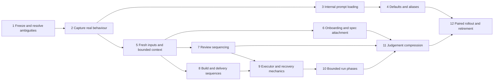

# Skill determinism implementation plan

> **For agentic workers:** REQUIRED SUB-SKILL: Use superpowers:subagent-driven-development or superpowers:executing-plans to implement this plan task-by-task. Steps use checkbox syntax for tracking.

**Goal:** Reduce resident skill context substantially while moving mechanical flow into deterministic CLI operations with demonstrated parity and preserving semantic judgement.

**Architecture:** Keep existing canonical records and governed effect commands. Extract bounded sequences into factory commands, with typed requests for judgement at the points that require it. A manifest selects small internal prompt fragments; it does not create a second scheduler, history or source of authority.

**Tech stack:** Node 20+ shipped JavaScript, TypeScript for new `bin/lib` modules, Node 22.18+ for contributor builds, `node --test`, existing CLI contracts and eval runners.

**Spec:** [Pinned audit](README.md), including its three semantic inventories and [experiment protocol](measurements.md).

This plan lives beside the audit because the repository explicitly ignores `docs/superpowers/`; the reviewable plan must remain in the versioned evidence tree.

## Global constraints

- New `plugin/skills/faff/bin/lib/` modules are TypeScript. Commit authored `.ts`, generated `.js` and `build-manifest.json` together. Small edits to existing JavaScript stay JavaScript.
- Adopters run Node 20 or later with no new runtime dependencies. Contributors build with Node 22.18 or later.
- New tests live in `test/`, not in new selftest blocks. New factory commands have `REGION_SELFTEST_ARGV[cmd] = null` and a `TEST_FILE_COVERAGE` entry. Governance commands retain the existing selftest exception until FAFF-1419, the selftest retirement, lands.
- Read `docs/reference/skill-authoring.md` before every skill change. Put the rule inventory in an added spec under the configured spec docs path, normally `records/specs/`, so the existing CI check actually sees it.
- Every changed/deleted obligation has a source quote, replacement owner, observable behaviour and covering test. Classify preserved, explicitly changed, or dropped with a reason. Prose-to-docs relocation is still a deletion from the runtime contract.
- Semantic judgements remain prompts: design choice, founded objections, ambiguity interpretation, confidence reasoning, product value and explanatory quality. A deterministic threshold or finite routing table belongs in code even though it is a decision.
- Do not lower an approval, eligibility, holdout, custody, retry or effect boundary while claiming extraction parity. Fix a conflict in a separate reviewed change or pin the differing branches until resolved.
- Existing explicit slot settings and third-party producers survive. A default-policy change is separate from an extraction and separate from naming.
- Public product copy says SuperDomestique and Commissaire. Existing technical identifiers remain `faff` until a separately accepted rename.
- No new canonical history. V5 technical design records per-record-kind canonicality in the existing chain. Preserve suppression and ownership of schema:2/schema:3 records at governed effect boundaries.
- A full coordinator, service, public pack SDK or canonical rename requires its applicable V5 gate. The user's cost trigger justifies this measurement and bounded extraction work; it does not prove those gates have passed.
- Commit with the operator's `Signed-off-by` identity. Each slice should be independently revertible without reverting unrelated user changes.

## Review focus

1. A cold standalone producer must receive its complete contract and rubric, even when no parent has loaded the kernel. Covered in tasks 3 and 4.
2. A timeout after an effect succeeds must not repeat that effect or claim failure from missing acknowledgement. Covered in tasks 2, 6, 8 and 10.
3. A human changes labels, comments, approval or head between planning and execution. The command must detect stale input at the protected boundary. Covered in tasks 5, 6 and 8.
4. A malformed or empty capture must never produce a parity pass. Covered in tasks 1 and 2.
5. An old/custom slot name, unavailable adversarial backend or a mixed installation must not silently select weaker behaviour. Covered in tasks 3 and 4.

## Delivery order



Start with tasks 1 and 2, then task 3 and one bounded extraction from tasks 6 or 7. This yields measurable prompt and control improvements before attempting the larger run-loop work. Tasks 4 and 11 must not contaminate a mechanical parity comparison by changing reviewer policy or rubric simultaneously.

## Shared proof and interface rules

The new `eval/control-parity.mjs` is a comparator substrate, already present with mutation tests. It compares supplied traces only. Task 2 must supply real old/new drivers and a recorder before its pass can support an extraction claim.

Each proposed factory operation has a command-specific discriminated result. The common shape below is a boundary convention, not a new persisted state machine:

```ts
type BoundaryResult<T, J> =
  | { kind: "complete"; value: T }
  | { kind: "needs-judgement"; request: J }
  | { kind: "await-human"; reason: string }
  | { kind: "blocked"; reason: string };
```

Requests identify the input digest, selected prompt version, expected response schema and evidence limits. A returned judgement cannot declare its own authority, change the policy snapshot or authorise a protected effect. Failure to parse, stale evidence or a missing answer fails closed. Reuse existing result types where they already define the command's contract; do not rewrite them merely to match this convention.

Every task ends with: targeted tests, build and manifest checks if TypeScript changed, `faff regions check`, `faff validate-adapters`, affected eval discovery, rule-inventory verification against the actual base, trace comparison and a signed-off commit. Run the complete required CI suite before integration. Do not raise prompt baselines to hide growth; lower them only after the replacement is verified.

### Task 1: Pin behaviour and resolve the ambiguity register

**Files:** Existing audit files; create `eval/control-parity/scenarios.json` and `eval/control-parity/ambiguities.json`; test `test/control-parity-coverage.test.mjs`. Follow existing spec conventions under `records/specs/` for the task's executable contract.

**Consumes:** Current commit, source block hashes, semantic audits and existing state-authority map.

**Produces:** A scenario registry of `{name, source_ranges, input_fixture, expected_effects, expected_terminal, ambiguity_status}`. Every changed obligation maps to a scenario or an explicit judgement eval.

- [ ] Record the spec-body discovery conflict, custody/recovery divergence, refutation parser discrepancy, environment seed discrepancy, onboard mode discrepancy, jot existing-ticket routing drift and capability-based holdout discrepancy from the audits.
- [ ] For each conflict, record current executable behaviour, current prompt instructions and observed evidence separately. Choose the intended rule explicitly; leave unresolved cases blocking their own slice.
- [ ] Add `empty coverage cannot pass`, `zero graded denominator cannot pass`, `source hash changed requires re-review`, and `every deleted obligation has an owner` tests. Assert missing coverage produces non-zero even when `shadow-fidelity` says `null_result:false`.
- [ ] Capture immutable baseline source/fixture/policy hashes and current CLI outputs in scratch repositories. Preserve failure outputs as well as successes. Do not convert missing historical actions into synthetic observations. Investigate the 14 `next` divergences in the October replay, including correlation and kernel-version discipline, then add their distinct input/branch classes to the fixture matrix.
- [ ] Run `node --test test/control-parity-coverage.test.mjs test/rule-inventory.test.mjs test/shadow-fidelity.test.mjs`. Expected: all pass; an intentionally missing coverage row fails.

### Task 2: Capture and replay actual bounded operations

**Files:** Extend `eval/control-parity.mjs`; create `eval/control-parity/recorder.mjs`, `eval/control-parity/drivers.mjs`, `eval/control-parity/run.mjs`; extend `test/helpers/skill-harness.mjs` only through an optional injected recorder; create `test/control-parity-drivers.test.mjs`.

**Consumes:** Task 1 scenario registry, frozen fixtures and existing seeded-repo/mock-tracker helpers.

**Produces:** `captureScenario(driver, fixture): Promise<Trace>` with the existing comparator trace shape; `runPairs({baselineRoot,candidateRoot,scenarios,outDir})` writes paired traces and a provenance manifest. A driver returns observed effects and state, not a prewritten golden action list.

- [ ] Write failing tests where an implementation attempts a forbidden merge, repeats a successful mutation after a lost acknowledgement, skips a reread, or emits a terminal result without durable state. Assert each is visible and fails the independent oracle.
- [ ] Record tool requests and responses at the injected effect ports, then inspect resulting tracker/filesystem state. Use fake clock and stable IDs; normalise only explicitly declared nondeterministic fields. Preserve sequencing and byte hashes.
- [ ] Add crash points before an effect, after effect success/before persistence, and after persistence/before acknowledgement. Assert retries reconcile rather than blindly execute again.
- [ ] Keep a separately authored expectation for each scenario. Old/new equality can preserve an old bug; require both traces to satisfy the oracle. Label intentional old-bug corrections as behaviour changes, not parity.
- [ ] Run `node --test test/control-parity.test.mjs test/control-parity-drivers.test.mjs test/skill-harness.test.mjs`. Then run identical baseline versus baseline to validate capture, and seeded mutants to prove detection. Neither run establishes candidate parity yet.

### Task 3: Load internal prompts by role and phase

**Files:** Create `plugin/skills/faff/prompt-manifest.json`, `plugin/skills/faff/prompts/`; create `plugin/skills/faff/bin/lib/skill-context.ts`; modify `plugin/skills/faff/bin/faff`, `regions.js`, `lint-cli-coverage.js`, `validate-adapters.js`, `scripts/link-skills.sh`; tests `test/skill-context.test.mjs`, `test/link-skills-public-catalog.test.mjs`; extend `eval/skill-audit.mjs` for the new manifest.

**Consumes:** Reviewed dependencies from task 1 and slot-resolution configuration.

**Produces:** `resolveSkillContext({entry,phase,slot,mode}, manifest): {files, hashes, dependencies}` and `faff skill-context --entry NAME --phase NAME --json`. The manifest maps public entries to exact internal fragments and lists required contract descriptions. Initial moves preserve bytes.

- [ ] Write tests for standalone, parent invocation, fresh subagent, post-compaction reload, legacy alias, unknown phase, dependency cycle and missing fragment. Assert missing mandatory context fails instead of returning a partial prompt.
- [ ] Move shared producer procedures to internal prompt files without changing their wording. Keep old skill aliases functional during this step. Do not infer a dependency from a text search at runtime.
- [ ] Add an explicit public skill allowlist to installer/package preparation. Preserve owned-link semantics, foreign links, CLI binaries and worktree sourcing. Unknown custom producers remain explicitly addressable.
- [ ] Verify the installed artifact through both supported harness discovery paths. Count actual catalog entries and token usage; `user-invocable:false` alone is not a pass.
- [ ] Test role capability exclusions: evaluator prompt and dispatch must not expose source/worktree/tracker credentials; implementor must not acquire orchestrator-only tools merely through context composition.
- [ ] Run the task tests plus `test/link-skills-worktree.test.mjs`, `test/link-skills-cli-bins.test.mjs` and the paired loading experiment. Roll back by restoring the prior manifest/package; retain old alias resolution until compatibility tests pass.

### Task 4: Separate role names, defaults and optional implementations

**Files:** Modify `config-core.js`, slot resolver introduced in task 3, `.faffrc.example.yaml` if still the shipped example, `validate-adapters.js`, `eval/seam-registry.json`; add `test/slot-compatibility.test.mjs`, extend `test/config-defaults.test.mjs`.

**Consumes:** Task 3 aliases and the maintainer's 14 November decision: dark defaults, noon set aside and retained until third-party usage informs retirement.

**Produces:** Stable role identifiers resolving to one implementation, with old names accepted as aliases and an inspectable resolution result including source/default/explicit provenance.

- [ ] Preserve all nine unique noon occupants. Extract the noon review phase, spec self-review and shared methodology procedures before deleting a body their dark counterparts use.
- [ ] Set the five defaults to `faffter-dark-nlspec`, `faffter-dark-spec-review`, `faffter-dark-adversarial-review`, `faffter-dark-methodology-agile-delivery` and `faffter-dark-concurrency-parallel`. Test the review defaults first, then methodology and concurrency as separate behaviour-changing sub-slices. Preserve explicit overrides, caps and capability checks; unavailable parallel infrastructure must report its existing refusal instead of silently choosing another mode.
- [ ] Remove noon entries from normal discovery and default context. Keep noon selectable through explicit configuration and legacy identifiers, loading it only on request or where a dark implementation still needs a shared procedure. Nine unique noon capabilities remain available behind role-based internal prompts; do not delete their functionality because of their historical name.
- [ ] Assert explicit custom and old identifiers retain behaviour, missing backend fails visibly, and adversarial unavailability never falls back silently to basic review. Assert default changes do not retroactively reinterpret a pinned running operation.
- [ ] Run separate quality/cost arms for old and proposed defaults; do not compare them as a prompt-only change. Retain old implementation mode until consumers and eval results justify retirement.
- [ ] Run `node --test test/config-defaults.test.mjs test/slot-compatibility.test.mjs` and affected judgement evals. Publish migration/rollback mapping before changing installed defaults.

### Task 5: Make fresh input collection explicit

**Files:** Create `plugin/skills/faff/bin/lib/context-snapshot.ts`; reuse `tracker-probe.js`, `state.js`, `graft-admit.ts`, `dispatch.js` and existing adapters; tests `test/context-snapshot.test.mjs`.

**Consumes:** Connector results, repo state, existing config and phase requirements from task 3.

**Produces:** `buildContextSnapshot(input): {schema:1, phase, source_versions, content_hashes, facts, missing}` and `validateSnapshot(snapshot, currentVersions)`. This is evidence input, not a second canonical ledger.

- [ ] Write tests for truncated pagination, missing connector capability, unavailable pinned connector, stale head, changed issue comments/labels and invalid confidence. Assert unknown stays unknown rather than defaulting to approval.
- [ ] Reuse transport calls, but make pagination and required-field validation deterministic. Where the CLI cannot directly access the connector, validate submitted envelopes and state the trust limit; do not claim freshness merely because a caller supplies a timestamp.
- [ ] Make every protected command reread the authoritative state it can access at the effect boundary. Where a connector lacks compare-and-set, preserve the existing best-effort limitation and test the race instead of claiming a hard mutex.
- [ ] Keep conflicting spec-discovery rules blocked until task 1 resolves them. Do not generalise `state.js` local fallback into a new universal discovery authority.
- [ ] Run the task suite and `test/graft-admit.test.mjs`, `test/graft-admit-replay.test.mjs`. Assert detectably stale snapshots cannot authorise a command-owned effect. Document the remaining race where the connector cannot supply a current version or compare-and-set.

### Task 5a: Extract pure text and template mechanics

These can ship independently after task 2, before the more expensive orchestration changes. Each row is a separate reviewable slice; none performs tracker writes.

| Files and interface | Source responsibility | Required fixtures |
|---|---|---|
| New `bin/lib/review-comment.ts`: `spliceReviewComment({comments,issueId,regionText}): {commentId,body,expectedDigest}` | Select the appropriate managed review region and preserve human text | No/one/multiple markers, oldest complete region, legacy open-only marker, hostile quote text, byte-identical human prefix/suffix, repeated operation, concurrent edit digest mismatch |
| New `bin/lib/ticket-template.ts`: `resolveTicketTemplate({nativeBody,overrideBody,defaultBody,type}): {source,headings,placeholders}` | Resolve skeleton precedence and heading extraction | Native/override/default precedence, missing connector, malformed native body, custom paths, epic/container skeleton, unknown type; type inference stays judgement |
| New `bin/lib/producer-block.ts` only if a shared extraction is justified: `extractProducerBlock(text, contractName): {kind:"found",json:string}\|{kind:"absent"}\|{kind:"invalid",reason:string}` | Markdown contract block selection for remaining review/delivery consumers | Zero/one/multiple blocks, fenced example, wrong info string, malformed JSON, hostile content, byte-preserved payload; absence policy remains contract-specific |

All `bin/lib` paths above are under `plugin/skills/faff/`. Reuse `prep-attach` readiness parsing and the holdout parser rather than changing their accepted language incidentally.

- [ ] Add `test/review-comment.test.mjs`, `test/ticket-template.test.mjs` and, if the shared parser is needed, `test/producer-block.test.mjs`, using the listed fixtures and frozen expected bytes.
- [ ] Implement only pure transformations first, with command registration and the standard factory coverage entries. The orchestrator remains responsible for the actual effect through its established boundary.
- [ ] Exercise the functions through the real CLI, including malformed input and conservative exits. Then wire one consumer at a time and compare its observed read/write sequence and final bytes.
- [ ] Delete only the replaced mechanical prose, keeping finding-summary judgement, template content authoring and per-contract failure policy. Run the relevant prompt evals and rule-inventory check before accepting the slice.

### Task 6: Extract first-run and spec attachment sequences

**Files:** Create `plugin/skills/faff/bin/lib/onboard-prepare.ts`; extend `prep-attach.ts`; modify only corresponding sections of gateway/onboard/prep and tracker references; tests `test/onboard-prepare.test.mjs`, `test/prep-attach.test.mjs`.

**Consumes:** Config path/status, explicit human answer or autonomous mode, proposed spec bytes and connector capabilities.

**Produces:** `prepareOnboarding(input, ports): BoundaryResult<SetupResult, DetectionQuestion>`; extend attachment with transport acknowledgement and optional authoritative readback, preserving the current stage/confirm API compatibility.

- [ ] Capture acceptance, decline-stub, real config, deliberate re-onboard, local/standard mode precedence, no config unattended, hook unsupported and hook failure. Include partial failure between config initialisation and bundle-store setup, and the local-mode native-map exception. Assert unattended runs neither prompt nor create config; acceptance/decline preserve their intended hook/gitignore parity.
- [ ] For attachments, test wrong issue, mismatched bytes, reused comment ID, network error before write, lost acknowledgement after write, remote human edit and absent readback capability. Assert local confirmation is not reported as remote verification.
- [ ] Move config stub/ensurer ordering and deterministic attachment bookkeeping into commands. Retain choices of tracking system and interpretation of comments in prompts.
- [ ] Run paired real-prompt scenarios before replacing each prose sequence with a concise command/result instruction. Include rule-inventory rows for every exception and failure branch.
- [ ] Run the task tests plus existing decline parity tests. Roll back command use at the prompt boundary while retaining compatible stored attachment artifacts.

### Task 7: Complete review transport and convergence ownership

**Files:** Extend `spec-review-round.ts`, `spec-review-hold.ts`, `spec-review-convergence.js` where needed; review current `faffter-dark-spec-review/review-call` helpers before adding code; add `test/review-sequence-parity.test.mjs`; update only review-related prompt sections.

**Consumes:** Pinned spec/head, selected lenses/backend, previous review history, typed objections and human decisions.

**Produces:** Context assembly and a bounded dispatch/acknowledgement sequence around existing review-round commands. Existing round/hold/convergence commands remain the sole owners of their counters, pins, decisions and continuation rules. Objection merit and disposition remain explicit judgement inputs.

- [ ] Characterise missing claim/evidence/consequence, skipped lens, malformed response, backend fallback, changed spec during review, no-progress loop, exhausted cap and awaiting-human state. Resolve the parser/prose conflict first.
- [ ] Assert caps, history windows, pins and holds derive from authoritative records. Returning `label_ops` is a proposal; separately capture whether and how they were applied.
- [ ] Reuse existing parse/aggregate/judge commands and served-dispatch data. Do not reconstruct the model identity from configured intent after fallback.
- [ ] Delete repeated shell choreography only after ordered trace parity passes. Keep architecture, security, QA and founded-objection rubrics in selected lens prompts.
- [ ] Run existing `spec-refute-parse`, `spec-refute-aggregate`, `spec-review-occupant-served-dispatch` suites and the new parity suite; run affected refutation/verdict evals with pinned model and effort.

### Task 8: Complete build and delivery sequence boundaries

**Files:** Extend `graft-admit.ts`, `pr-open.ts`, existing gates/merge commands only where proof finds a missing boundary; reuse `worktree-ensure.ts`, `spec-commit.ts` and `land.ts` for their already-owned sequences. Add `plugin/skills/faff/bin/lib/graft-stage.ts` only for remaining sequence ownership; tests `test/graft-stage.test.mjs`; slim the corresponding graft/build/review sections.

**Consumes:** Fresh task 5 facts, spec/head, gate/review artifacts and current capability facts.

**Produces:** `runGraftStage(stage, input, ports): BoundaryResult<StageResult, StageJudgement>` for individually named stages, not a whole-run daemon. Existing commands retain their JSON/exit contracts.

- [ ] Record baseline admission and PR creation using the already shipped commands first. Inventory what is still merely caller-supplied, including tracker freshness and approvals.
- [ ] Test dirty worktree, stale review head, changed approval, failed gates, infrastructure versus code CI failure, absent holdout, holdout required outside L4, existing PR, interrupted PR creation and merge receipt disagreement.
- [ ] Route command-owned PR/merge effects through the current chokepoints. Assert forbidden attempts there are recorded and refused, ledger truth agrees with actual Git/PR state, and no duplicate schema:2 observation accompanies a covered schema:3 effect. Caller-owned tracker, label and file writes retain their existing detective limits unless a new effect bridge actually owns and prevents them.
- [ ] Retain coding/design/review judgement in prompts. Return a typed fault-domain request when the log requires interpretation; an unknown judgement must not turn into retry or merge.
- [ ] Run `test/graft-admit*.test.mjs`, `test/pr-open.test.mjs`, relevant merge/custody suites and the new stage tests. Only then shorten the stage's prose and compare real-prompt traces.

### Task 9: Unify executor bookkeeping and corrective recovery

**Files:** Create `plugin/skills/faff/bin/lib/executor-step.ts`; reuse current corrective/custody/evidence/run-ledger modules; modify sequential and parallel executor prompt sections; tests `test/executor-step.test.mjs`.

**Consumes:** Admitted queue, executor mode/cap, run facts, custody manifest, child result and observed artifacts.

**Produces:** `reconcileExecutorStep(input, ports): ExecutorStepResult` with launch/reconcile/stop proposals, explicit required judgement and existing canonical record references.

- [ ] Resolve the sequential/parallel trust-verdict and manifest discrepancy in task 1. Establish whether the selected correction changes either observed implementation.
- [ ] Test peer claim, same-session resume, missing child token, false child success, lease expiry, stale corrective directive, held manifest, process death and duplicate completion. Assert disk/Git/evidence override a child's claim.
- [ ] Preserve parallel cap, issue/worktree isolation, claim ownership and joins. Do not turn sequential into parallel simply because both implementations now share bookkeeping.
- [ ] Extract repeated ledger updates, heartbeat placement, cancellation and corrective validation. Keep implementation and recovery judgement outside the command only where evidence cannot determine it.
- [ ] Run both executor modes against the same event-order/fault matrix, then real-prompt paired runs. Do not delete either mode until their distinct policy remains selectable.

### Task 10: Replace bounded unattended phases

**Files:** Extend `run-trigger.ts`; create `plugin/skills/faff/bin/lib/run-phase.ts` for bounded assembly/admission/reconciliation work; reuse queue-state/run-done/disposition/reconcile; tests `test/run-phase.test.mjs`; edit beep-boop/autonomous/park sections in separate phase slices.

**Consumes:** Run trigger, current canonical records, refreshed tracker facts, typed methodology rankings and executor outcomes.

**Produces:** `runPhase(phase, input, ports): BoundaryResult<PhaseResult, PhaseJudgement>`. Each call terminates with a bounded result and records through current owners.

- [ ] Test plan/drain/refuse, empty queue, all blocked, malformed ledger, stale status, changed eligibility, retry-later resume, stopped run and incomplete admitted work. Include build-only never dispatching prep, wave-one empty with incomplete PRD, persisted no-progress/touched state and eager filing before the budget check. Assert neither an empty observation nor missing evidence means done.
- [ ] Preserve each entry's actual order: refresh and classify, select through validated methodology output, final admission before the admitted append, build claim inside graft, separate landing claim, execution, reconciliation, recording and termination assessment. Do not impose one generic claim/admit sequence. Test every mutation boundary with interruptions.
- [ ] Move immutable mechanical selection filters and retry/cap/termination rules into the command. Keep value prioritisation, scope shaping, topology judgement and ambiguity resolution in small methodology prompts.
- [ ] Keep execution behind the existing `faff` surface. If this grows into a persistent scheduler/coordinator, stop this slice at its bounded boundary and bring the measured evidence to the V5 gate.
- [ ] Run `test/run-trigger.test.mjs`, relevant queue/reconciliation/runcheck suites and the new phase tests; compare actual old/new phase traces before deleting each phase's prose.

### Task 11: Compress retained judgement without erasing constraints

**Files:** Selected internal prompts from task 3; `eval/seam-registry.json`, affected `eval/cases/` and loaders; create `test/judgement-prompt-coverage.test.mjs`.

**Consumes:** Mechanical responsibilities already removed and the retained-rule lists in the semantic audits.

**Produces:** Short role/lens prompts with explicit inputs, rubric, evidence requirements and typed output. No duplicated enum/default tables.

- [ ] Map each remaining sentence to a judgement obligation, output requirement, context need or removable explanation. Keep counterexamples where they distinguish common false approvals; deleting all examples is not a safe compression rule.
- [ ] Add adversarial fixtures for unsupported assumptions, criterion omission, over-objection, misleading tool content, insufficient evidence, out-of-scope changes, rendering that changes meaning and partial connector evidence.
- [ ] Register currently unacknowledged judgement seams, including adapter validation or environment subject selection if retained as model decisions. A `judgement_seam:none` label is not proof of determinism.
- [ ] Change one rubric family at a time, keeping CLI, defaults and model/effort fixed. Run the paired non-inferiority protocol and inspect every safety-sensitive disagreement.
- [ ] Run the coverage test and affected live evals. Preserve baseline files until the supervised baseline acceptance step; a candidate run cannot approve its own new reference.

### Task 12: Measure, roll out and decide retirement

**Files:** Measurement artifacts under `verification/audits/` or a dated successor; loader/default compatibility tests; prompt-size ratchets; relevant install and migration documentation.

**Consumes:** Passing per-slice proof, stable packaging and the separate policy-default experiment.

**Produces:** A release decision with measured token/cost/time/quality effects and explicit remaining limits.

- [ ] Run the six separate arms in the audit protocol. Report cold/warm cache, parent and child contexts, actual loaded file hashes, request/tool counts, total cost per completed task, p50/p95 elapsed time and failure/intervention rates.
- [ ] Compare against preregistered thresholds. Keep failed and inconclusive runs. A smaller prefix with worse total cost or quality is not an automatic success.
- [ ] Roll out one bounded command/phase at a time, initially to controlled fixtures and then representative attended work. Shadow comparisons may read live facts; they must never duplicate real effects.
- [ ] Retain compatible old prompt/command paths through one declared rollback window. Reverting a prompt alias must not undo durable records or downgrade a running run's pinned policy.
- [ ] Retire a basic implementation only after third-party usage exists and has been assessed, no default/internal delegation/eval loader still requires its body, and explicit/legacy selections have an accepted migration. Until then keep it set aside and opt-in. Absence from this maintainer's recent runs is insufficient to prove no adopter uses it.
- [ ] Lower size baselines and record final figures. Report deterministic coverage separately from live judgement evidence and from V5 assurance claims.

## Per-slice completion record

Each slice leaves a compact evidence directory containing source/fixture/config hashes, old/new normalised traces, independent oracle results, fault-injection results, affected judgement eval results, prompt-size and cost/time readings, rule-inventory output, required CI results and a rollback procedure. If a component was not exercised, state it as unproven. A slice is complete only when its required proof is present, not when its prose is shorter.
